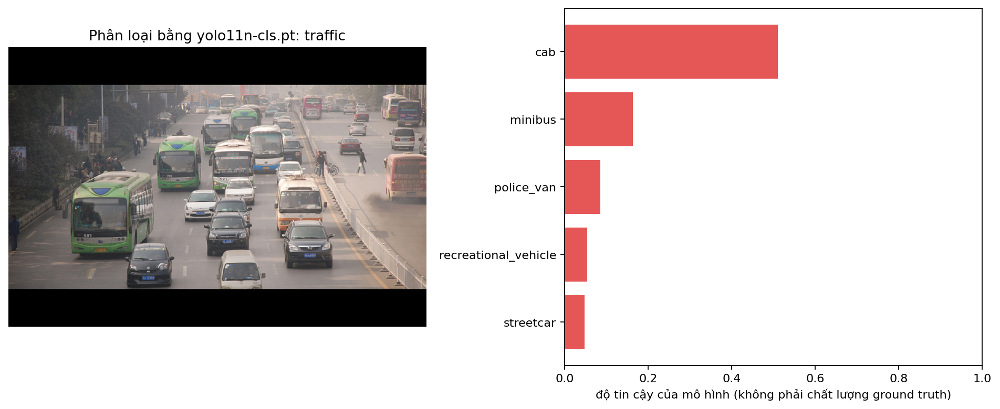
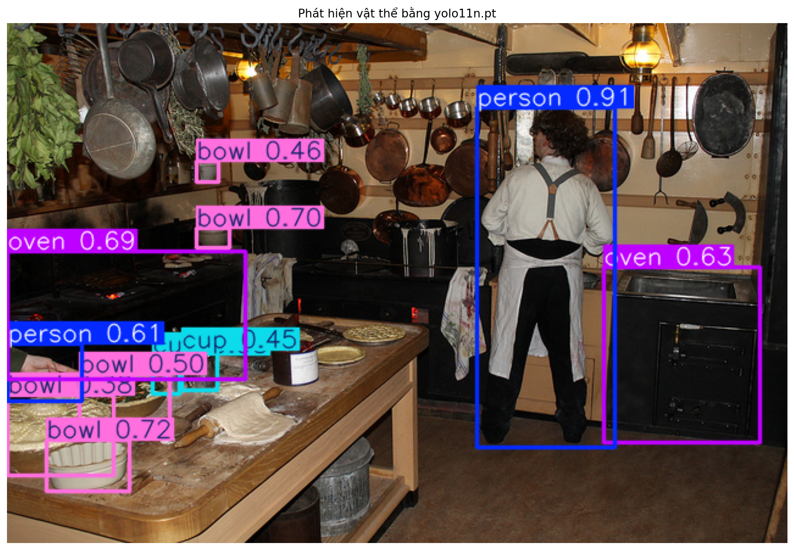
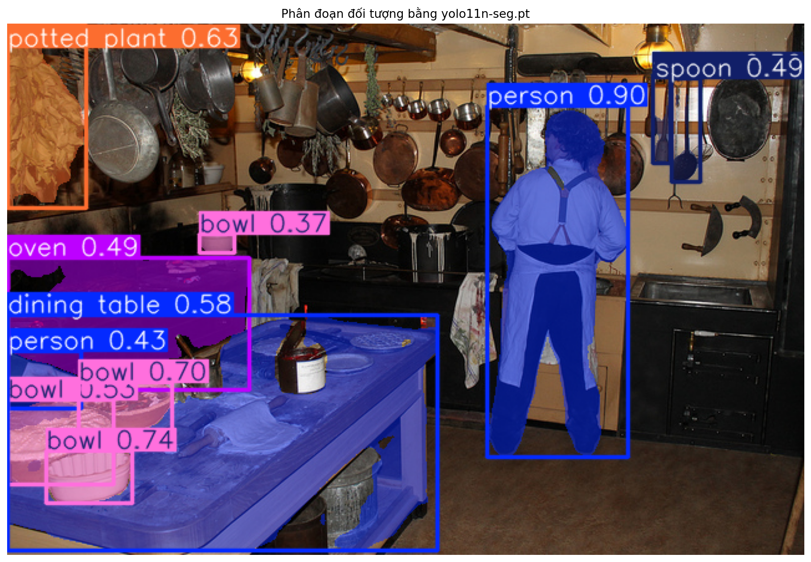

# Báo cáo bài thực hành Ngày 1 – Đọc prediction YOLO11 để hiểu định dạng nhãn

**Ngày chạy:** 06/11/2026 (giờ Việt Nam).

**Môi trường thực tế:** chạy cục bộ trên macOS bằng Python trong Terminal của workspace VS Code; CPU. Không sử dụng runtime Colab trong lần chạy này.

**Python / PyTorch / Ultralytics:** `3.9.6` / `2.8.0` / `8.4.145`.

**Checkpoint:** `yolo11n-cls.pt`, `yolo11n.pt`, `yolo11n-seg.pt`.

**Ngưỡng detection/segmentation tạo JSON:** `0.35`. Ô so sánh detection chạy thêm `0.20` và `0.60`, đúng notebook.

**Thay đổi so với notebook nguồn:** thực thi các ô Python gốc bằng `scripts/run_day1_local.py` trên CPU cục bộ. Bước `%pip` được thực hiện trước trong môi trường `.venv`; dùng backend Matplotlib `Agg` để lưu PNG; thay thao tác upload/download Colab bằng đọc/ghi file trên máy. Không sửa notebook nguồn, checkpoint, ảnh, mã suy luận, ngưỡng hay mã validation. 

**Dữ liệu và tái lập:** chỉ sử dụng ba ảnh COCO cố định: `traffic` (210273, 640 × 428), `kitchen` (397133, 640 × 427), `dining` (166918). Cả ba checkpoint và ba ảnh đều vượt qua kiểm tra SHA-256 trước khi suy luận. Hash checkpoint có trong từng record JSON; nguồn ảnh và giấy phép có trong [IMAGE_ATTRIBUTION.md](day1_lab_outputs/IMAGE_ATTRIBUTION.md). Nhật ký thực thi và thông tin môi trường được lưu riêng ở `outputs/day1_execution.log` và `outputs/day1_run_metadata.json` của workspace.

**Kết quả kiểm tra:** ô validation gốc của notebook báo `PASS`: đủ ba JSON, ba PNG, attribution và `instance_id` duy nhất. Tổng cộng có 15 record phân loại, 53 record detection và 49 record segmentation trên ba ảnh; đây là số prediction, không phải số nhãn ground truth đã xác nhận.

## 1. Phân loại ảnh

**Mở file:** [classification_predictions.json](day1_lab_outputs/classification_predictions.json) và [classification_top5.png](day1_lab_outputs/visuals/classification_top5.png). Dùng `sample_id = traffic`, `rank = 1`.

1. **Record hạng 1:** `sample_id=traffic`; `class_id=468`; `class_name=cab`; `rank=1`; `score=0.510915`; `taxonomy_name=ImageNet-1K`; `model_file=yolo11n-cls.pt`.

2. Record mô tả **toàn bộ bức ảnh**. Đây là tác vụ image classification: một ảnh đầu vào tạo danh sách các lớp được xếp hạng. Record này không có tọa độ box hoặc polygon để chỉ một chiếc xe riêng trong ảnh. Năm record của `traffic` là năm ứng viên lớp cho cùng ảnh, không phải năm vật thể.

3. Danh sách lớp đến từ **taxonomy ImageNet-1K đi kèm checkpoint** đã được huấn luyện. Mô hình tính score trên các lớp có sẵn rồi xếp hạng; không tự đặt ra tên lớp mới trong lần dự đoán này.

4. Cần ghi đủ `class_id`, `class_name`, `taxonomy_name` để xác định chính xác mã lớp thuộc danh sách nào và diễn giải bằng tên dễ hiểu. Một mã số có thể mang nghĩa khác khi chuyển taxonomy; chỉ một tên lớp cũng chưa xác định được hệ nhãn đang dùng. Ví dụ `468/cab` ở đây thuộc ImageNet-1K, còn hai tác vụ bên dưới dùng COCO-80.

5. Với ảnh nhiều vật thể, guideline cần quy định mục tiêu phân loại, cách chọn chủ thể chính và thứ tự ưu tiên khi nhiều lớp cùng phù hợp; phải có cách xử lý trường hợp không phân biệt được. Đề xuất cho một dự án single-label: chọn lớp của chủ thể chính theo tiêu chí đã thống nhất và có ví dụ chuẩn; trường hợp hòa hoặc không đủ dấu hiệu thì chuyển reviewer/Lab Coach. Không tự chọn lớp chỉ vì model xếp nó hạng 1.

6. `score=0.510915` là score của model để xếp hạng dự đoán, không chứng minh nhãn đúng và không phải điểm chất lượng nhãn người. Trên ảnh `traffic` có nhiều xe buýt và ô tô; chỉ nhìn toàn cảnh chưa đủ để xác nhận chủ đề duy nhất là taxi (`cab`). Ground truth cần người gán nhãn đối chiếu taxonomy và guideline. Không thể diễn giải score này thành “51,0915% nhãn người gán là đúng”.

**Quan sát có bằng chứng:** hình top-5 cho thấy `cab` đứng đầu, tiếp theo là `minibus`, `police_van`, `recreational_vehicle`, `streetcar`. Đây là cảnh giao thông nhiều loại xe, vì vậy việc gán một lớp cho cả ảnh có điểm mơ hồ về chủ thể. Không khẳng định `cab` đúng hoặc sai chỉ dựa vào thứ hạng.

## 2. Phát hiện vật thể

**Mở file:** [detection_predictions.json](day1_lab_outputs/detection_predictions.json) và [detection_predictions.png](day1_lab_outputs/visuals/detection_predictions.png). Dùng `sample_id = kitchen`.

1. **Record được chọn:** `sample_id=kitchen`; `class_id=45`; `class_name=bowl`; `score=0.719063`; `bbox_xyxy=[32.65, 342.12, 100.16, 384.93]`; `bbox_width=67.51`; `bbox_height=42.81`; `coordinate_unit=pixel`; `taxonomy_name=COCO-80`; `score_threshold=0.35`.

2. Đây là hộp dự đoán quanh chiếc bát sáng màu ở phần dưới bên trái ảnh. Gốc tọa độ `(0, 0)` nằm ở góc trên trái ảnh gốc 640 × 427 pixel; x tăng sang phải, y tăng xuống dưới. Góc trên trái của hộp là `(32.65, 342.12)`, góc dưới phải là `(100.16, 384.93)`. Hộp rộng `100.16 − 32.65 = 67.51` pixel và cao `384.93 − 342.12 = 42.81` pixel. Tọa độ thuộc ảnh gốc, không phải kích thước PNG minh họa sau khi lưu bằng Matplotlib.

3. **So sánh ngưỡng trên cùng ảnh `kitchen`, cùng checkpoint:**
   - `0.20`: **17** prediction.
   - `0.35`: **11** prediction (mức dùng cho JSON bài nộp).
   - `0.60`: **6** prediction.

   Khi so `0.20` với `0.60`, hạ ngưỡng giữ thêm 11 prediction. Nhật ký ô so sánh cho thấy mức `0.20` có thêm các lớp như `spoon`, `potted plant`, `dining table`, `bottle`; mức `0.60` chỉ còn hai `person`, hai `bowl`, hai `oven`. Các con số này là số dự đoán sau lọc; chưa phải số vật thể đúng thực tế.

4. Khi hạ ngưỡng, reviewer phải kiểm tra thêm từng hộp được giữ lại: lớp có phù hợp hình ảnh không, hộp có ôm đúng một vật thể không, có trùng lặp hoặc chỉ bao nền không. Đồng thời vẫn phải quét toàn ảnh để phát hiện vật bị bỏ sót. Score thấp không tự động nghĩa là sai; score cao cũng không miễn kiểm tra. Ngưỡng model không phải quy tắc bỏ qua vật thể khi tạo ground truth.

5. **Quy tắc box đề xuất:** với nhãn theo phần nhìn thấy, vẽ hình chữ nhật song song cạnh ảnh nhỏ nhất bao toàn bộ phần quan sát được của một vật thể, không cố ý lấy thêm vùng nền và không vượt ranh giới ảnh. Mỗi vật thể có box riêng. Với phần bị che, không tự suy diễn kích thước ngoài phần nhìn thấy; nếu dự án yêu cầu box toàn vật thể (amodal), cần guideline riêng được phê duyệt.

6. **Trường hợp cắt mép:** bên trái ảnh có một phần người, chủ yếu là vùng tay, đi từ ngoài khung hình vào. JSON có record `person`, `score=0.61093`, `bbox_xyxy=[0.12, 263.18, 61.55, 310.78]`; vị trí x gần 0 phù hợp vùng cắt mép quan sát được. Vì bài chưa cung cấp rule production về mức hiển thị tối thiểu để gán lớp `person`, cần **escalation cho Lab Coach** để xác nhận có gán nhãn hay không và cách giới hạn hộp. Sau khi thống nhất, đưa quy tắc vào guideline để áp dụng nhất quán cho các ảnh khác; không suy ra rule từ chính prediction này.

## 3. Phân đoạn theo từng đối tượng

**Mở file:** [segmentation_predictions.json](day1_lab_outputs/segmentation_predictions.json) và [segmentation_prediction.png](day1_lab_outputs/visuals/segmentation_prediction.png). Dùng `sample_id = kitchen`.

1. **Record được chọn:** `instance_id=kitchen-001`; `class_id=0`; `class_name=person`; `score=0.899318`; `polygon_point_count=348`; `taxonomy_name=COCO-80`; `score_threshold=0.35`. Năm điểm đầu của `polygon_xy` là `[[446.0, 70.0], [445.0, 71.0], [444.0, 71.0], [443.0, 72.0], [442.0, 72.0]]`, đơn vị pixel. Record này tương ứng người đứng ở vùng bên phải ảnh, với `bbox_xyxy=[385.45, 66.44, 498.02, 348.58]`.

2. Box chỉ cung cấp vùng chữ nhật bao vật thể, bao gồm cả nền bên trong. Polygon mô tả biên không đều của từng instance, giúp phân biệt vùng đầu, vai, cánh tay, thân và chân với nền. Ví dụ mask người có khoảng nền giữa hai chân, trong khi box vẫn chứa cả khoảng đó. Số điểm polygon là số đỉnh biểu diễn biên, không phải diện tích mask hay số pixel của người.

3. `instance_id` dùng để phân biệt từng đối tượng trong output lab. `kitchen-001` và `kitchen-009` đều thuộc lớp `person`, cùng `class_id=0`, nhưng là hai instance riêng. Vì vậy instance ID không thay thế class ID. ID cũng không bảo đảm nhận diện cùng một người ở ảnh khác hoặc qua các khung hình video; nó được đánh số theo kết quả từng ảnh, không phải tracking ID.

4. **Quy tắc mask đề xuất:** với nhãn theo phần nhìn thấy, vẽ biên bám theo vùng thực sự thuộc một instance, loại nền và phần thuộc vật thể khác; không nối hai vật cùng lớp thành một instance và không tự vẽ phần bị che. Reviewer cần kiểm tra các chỗ lõm, khe giữa các bộ phận và vùng vật thể tiếp xúc. Các quy định về lỗ trong mask, phần rời nhau hoặc biểu diễn amodal cần được guideline xác định rõ theo định dạng nhãn của dự án.

5. **Chỗ khó và lỗi cần kiểm tra:** vùng `dining table` (`instance_id=kitchen-005`, `score=0.578415`, 598 điểm polygon) có lớp phủ xanh lên một phần khăn trắng và khối bột ở mặt bàn phía trước. Đây là dấu hiệu mask có thể lẫn vật thể đặt trên bàn, cần đối chiếu ảnh và quy tắc gán nhãn. Nếu guideline xác định chỉ gán phần mặt bàn nhìn thấy, annotator phải loại phần khăn/bột khỏi vùng bàn. Nếu chưa rõ nhãn bàn có bao gồm vật đặt trên đó hoặc có dùng biểu diễn amodal hay không, cần **escalation cho Lab Coach**, không tự xem mask model là đáp án. Quan sát này chưa phải phép đo IoU hay kết luận chất lượng toàn bộ mask vì bài không cung cấp ground truth đối chiếu.

## 4. Vòng đời và kiểm tra chất lượng

Chuỗi production: `ảnh thô → guideline → ground truth → huấn luyện → prediction → QC/rework`.

Trong lần thực hành này chỉ có checkpoint đã huấn luyện sẵn và prediction; không tạo bộ ground truth đã được người kiểm duyệt, không huấn luyện lại mô hình. Bảng dưới mô tả công việc cần thực hiện nếu đưa các quan sát vào một quy trình gán nhãn thực tế.

| Tác vụ | Ground truth trông như thế nào? (đơn vị nhãn) | Lỗi hoặc chỗ khó quyết định trên ảnh/JSON | Annotator làm gì? | Reviewer xem gì? |
| --- | --- | --- | --- | --- |
| Phân loại ảnh | Một lớp thuộc taxonomy đã thống nhất cho toàn ảnh trong bài toán single-label. | `traffic` có nhiều loại xe; top-1 `cab`, score `0.510915`, chưa chứng minh đó là chủ thể duy nhất. | Đọc rule chọn chủ thể và ví dụ chuẩn; chọn lớp theo ảnh, chuyển ca không đủ dấu hiệu để hỏi. | Kiểm tra taxonomy, tính nhất quán khi nhiều chủ thể cùng xuất hiện; không chấp nhận chỉ vì rank 1. |
| Phát hiện vật thể | Mỗi vật thể thuộc phạm vi có một lớp và một bbox pixel theo guideline. | Vùng người/tay bị cắt ở mép trái `kitchen`; record `person` có box `[0.12, 263.18, 61.55, 310.78]`. | Áp dụng rule truncated/occluded sau khi được xác nhận; vẽ box đúng phạm vi và ghi ca khó. | Kiểm tra lớp, độ khít box, vật bị bỏ sót và tính nhất quán ở mép ảnh; phản hồi sửa hoặc escalation. |
| Instance segmentation | Mỗi instance có lớp và vùng mask/polygon riêng, theo quy ước về phần nhìn thấy. | Mask `kitchen-005` của bàn phủ lên một phần khăn/bột; hai instance `person` vẫn phải tách riêng. | Bám biên quan sát được, loại phần vật khác theo guideline, giữ instance riêng; hỏi khi rule chưa phủ. | Kiểm tra biên, vùng tràn sang vật khác, lỗ/khe và instance bị gộp; yêu cầu rework rồi duyệt lại. |

Guideline cần được thống nhất trước khi tạo ground truth. Ground truth sau kiểm tra mới được dùng cho huấn luyện/đánh giá. Prediction giúp phát hiện trường hợp cần xem lại nhưng không tự thay thế nhãn chuẩn. Khi reviewer phát hiện lỗi, annotator sửa theo phản hồi và reviewer kiểm tra lại; khi vấn đề thuộc rule, cần cập nhật guideline và rà soát các trường hợp tương tự.

## 5. An toàn dữ liệu

1. Chỉ dùng ba ảnh COCO công khai đã cố định và kiểm tra checksum, giữ nguồn/giấy phép đi kèm, không đưa ảnh cá nhân, dữ liệu nội bộ, dữ liệu khách hàng hoặc thông tin cá nhân bổ sung vào báo cáo/output công khai.

2. Nếu gặp ảnh hoặc dữ liệu ngoài phạm vi, dừng việc sử dụng và upload dữ liệu đó, báo **Lab Coach hoặc giảng viên phụ trách** để xác nhận cách xử lý trước khi tiếp tục.

## 6. Checklist trước khi nộp link repo

**Đã kiểm tra trên máy:**

- [x] `report/REPORT.md` đã trả lời sáu mục theo mẫu, có evidence từ cả ba JSON.
- [x] `day1_lab_outputs/classification_predictions.json`.
- [x] `day1_lab_outputs/detection_predictions.json`.
- [x] `day1_lab_outputs/segmentation_predictions.json`.
- [x] `day1_lab_outputs/IMAGE_ATTRIBUTION.md`.
- [x] `day1_lab_outputs/visuals/classification_top5.png`.
- [x] `day1_lab_outputs/visuals/detection_predictions.png`.
- [x] `day1_lab_outputs/visuals/segmentation_prediction.png`.
- [x] Ô validation gốc notebook báo `PASS` khi chạy cục bộ; môi trường và thay đổi đã ghi ở đầu báo cáo.
- [x] Đã đối chiếu JSON với ba PNG và ghi nhận điểm mơ hồ/lỗi cần kiểm tra.
- [x] Không thêm họ tên, MSSV hoặc dữ liệu cá nhân vào báo cáo/output; nguồn tác giả ảnh được giữ theo yêu cầu attribution.

